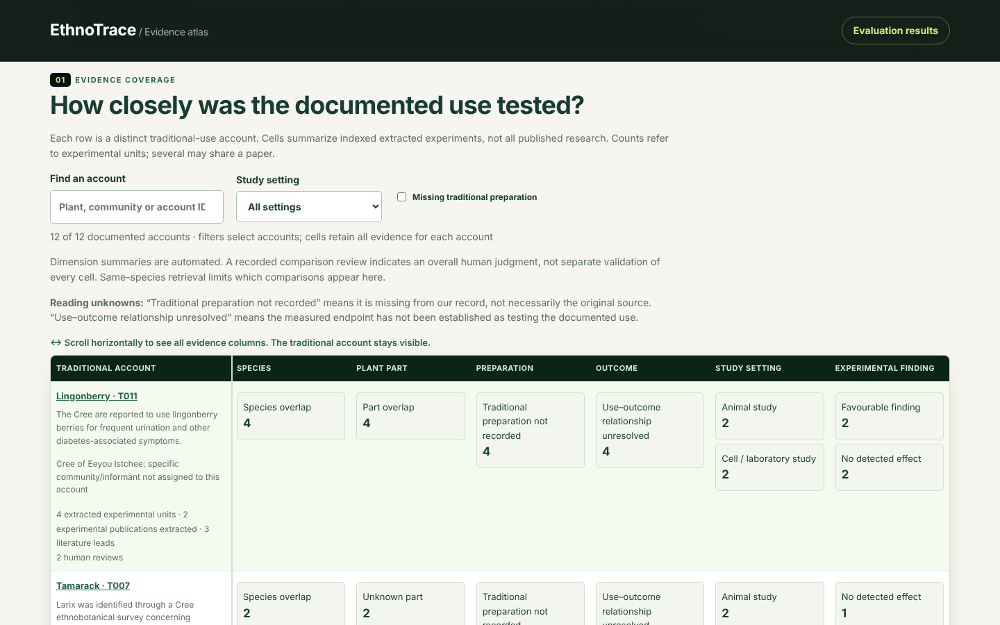

# EthnoTrace

Team: **ethnotrace**

**EthnoHack 2026 · Track 1: Traditional Knowledge Mining.** A shared plant name can hide differences in the plant part, preparation and outcome. EthnoTrace helps a researcher trace those differences from a Canadian traditional-use account to a cited experiment.

**How closely do experimental studies test documented Canadian traditional plant uses associated with blood-glucose regulation and diabetes-related symptoms, and where does the indexed evidence leave gaps in comparability or documentation?**

The atlas compares species, plant part, preparation and outcome for each documented account. An experiment may be useful because it reveals a mismatch. Its result is reported separately from how closely it tests the documented use.

| Current collection | Status |
| --- | --- |
| Traditional accounts | 12 Canadian accounts; nine identified species and two unresolved plant names |
| Experimental evidence | 12 extracted units from six publications; 51 publications indexed |
| Human retrieval relevance | 33 candidate pairs with 66 completed named reviewer submissions. All 33 pairs have matching human-approved assisted decisions, with documented assistant exposure and partner-reported approval. These are not independent blinded adjudication. |
| Ranking | Lexical, semantic and hybrid. All six indexed account queries now have complete assisted relevance judgments. Macro recall@5: lexical 0.828, semantic 0.889, hybrid 0.903. Precision@5: lexical 0.667, semantic and hybrid 0.733. These are assisted development results, not independent accuracy. Lexical remains the default. |

## Demo



Atlas interface during development. In the current app, try **Pitcher plant · T008 → Different part**. The E004 experiment used roots and measured cell survival; the traditional account describes leaves and slow-healing infections. Switch rankers to compare order, open the source, or [read the sample exported report](docs/reports/T008-evidence.md).

## Technologies, installation and keys

The viewer uses HTML, CSS and plain JavaScript. Python 3.11 or 3.12 serves the static files and runs the standard-library data pipeline; Node.js 22 (the CI version) is needed for rebuilding and JavaScript/report tests. Optional local model inference uses Sentence Transformers, Transformers, PyTorch and NumPy; [model attribution and setup](docs/semantic_retrieval.md) are documented separately.

No API keys or external inference services are required for viewing, rebuilding or testing the committed rankings. No environment file is needed. External links open the cited publications.

## Run locally

Download and unzip the repository from GitHub (**Code → Download ZIP**), or clone it with Git. Open a terminal in the directory containing this README. No packages need to be installed to view the app; with Python 3.11 or 3.12 installed, run:

```sh
python3 -m http.server 8000 --directory web
```

Open <http://localhost:8000>. The app uses committed data and rankings; viewing it requires no model installation or API keys. Stop the server with Ctrl+C.

To rebuild the committed outputs or check them without writing (Python 3.11 or 3.12 and Node.js):

```sh
python3 scripts/rebuild.py
python3 scripts/rebuild.py --check
```

## Exploratory frozen-ranker scores

The [assisted exploratory ten-paper evaluation](docs/archive/assisted_generalization_results_2026-11-05.md) ran the pinned lexical, semantic and hybrid rankers without changing the frozen original protocol. All methods scored Precision@5 = 0.800 and Recall@5 = 0.900. Semantic and hybrid improved Precision@3 from 0.833 to 1.000 compared with lexical. Labels were assistant-prepared and later approved by Alex, so this is **not independently blinded generalization evidence**.

## Ten-paper pilot literature screening

All ten frozen generalization candidates received source-based assistant research screening before rank exposure: nine assessed useful and one context only. Alex approved all ten source judgments with assistant-label exposure disclosed. The separate assisted exploratory evaluation is complete; the original blinded evaluator still rejects these exposed reviews. See [the source-screen report](docs/archive/generalization_source_followup_2026-11-05.md). These judgments are not independent human gold labels or performance metrics.

## Additional source-supported ethnobotanical context

A follow-up to the [missing-field audit](docs/missing_field_source_audit_2026-11-05.md) identifies related Cree diabetes-symptom plant parts for four records: T007 (tamarack inner bark), T009 (mountain ash inner bark, with branches separately reported), T010 (balsam poplar inner bark), and T012 (Labrador tea leaves). Original indexed claims remain unchanged. The evidence and limitations are stored in `data/curated/missing_field_source_evidence.jsonl` and exposed in the demo data as supplementary context, rather than silently changing frozen comparison labels or rankings.

## Limits

The Canadian scope applies to the accounts; experimental studies may come from anywhere. The collection is selective. Missing indexed evidence does not establish that no study exists. Preserve the original symptom descriptions, attribution and source-specific rights.

The six-query benchmark measures recovery of seeded links. Ten of twelve links share a publication across the account and experiment. Human relevance metrics cover six account queries with matching assisted reviewer decisions, without independent adjudication. Reviewer A (Nikolay-Machev) and Reviewer B (Alex Karadjov) have 20 completed comparison judgments each and agree on all 20 labels (6 insufficient evidence, 14 not directly comparable). Their decisions are recorded as assisted consensus with disclosed non-blinded provenance, not independent gold. Independent comparison accuracy is unavailable. Reviewer B has 20 recorded extraction-verification confirmations, while Reviewer A has none in the current files. The reviews were made with access to assistant screening and include abstract and secondary-source judgments. These development results establish neither general retrieval accuracy nor clinical efficacy.

[Documentation and build history](docs/README.md) · [Sources and licences](docs/rights.md) · [Hackathon provenance and AI disclosure](docs/provenance.md)

Human-reviewed lexical, semantic and hybrid results: [retrieval comparison](docs/human_retrieval_comparison.md). All six queried accounts now have complete confirmed assisted judgments and enter the development metrics.

Completed exploratory pilot: [new-paper review packet](docs/generalization_review_packet.md) and [frozen pilot protocol](docs/generalization_protocol.md). All ten new candidates have completed assisted approvals. The separate exploratory evaluation is shown on the evaluation page; independent blinded generalization performance remains unavailable. The atlas now gives a checkable completion criterion for each research gap.

[Product verification and limitations](docs/product_audit.md) distinguishes prior browser and JavaScript checks from the latest validated review counts, and records review provenance and verification limits.

## Validation and reproducibility

Run `python3 scripts/rebuild.py --check`, `python3 -m unittest discover -s tests`, `node tests/test_web.cjs` and `node tests/test_reports.cjs`. CI runs these checks with Python 3.11 and 3.12. Current aggregate metrics use `math.fsum` to avoid version-dependent floating-point summation differences.

Current retrieval evaluation runs through `scripts/evaluate_retrieval.py`, which reconciles all submitted reviewers per pair. A pending or provisional submission blocks scoring that account; conflicting final decisions stop evaluation for adjudication. `scripts/evaluate_semantic.py` remains the unchanged historical evaluator referenced by the frozen pilot manifest. The rebuild and evaluation page use the current evaluator.

Supplementary source evidence is visible below each account's gaps and in its downloaded report. These cited context notes do not replace original recorded values or change rankings and judgments. Targeted extractions show their recorded verification status and assisted provenance.

Project code and original technical documentation use the [MIT licence](LICENSE). Third-party datasets, source passages, publications, models and traditional knowledge retain their own rights and restrictions; this licence does not grant rights to those materials. See [rights and attribution](docs/rights.md).
